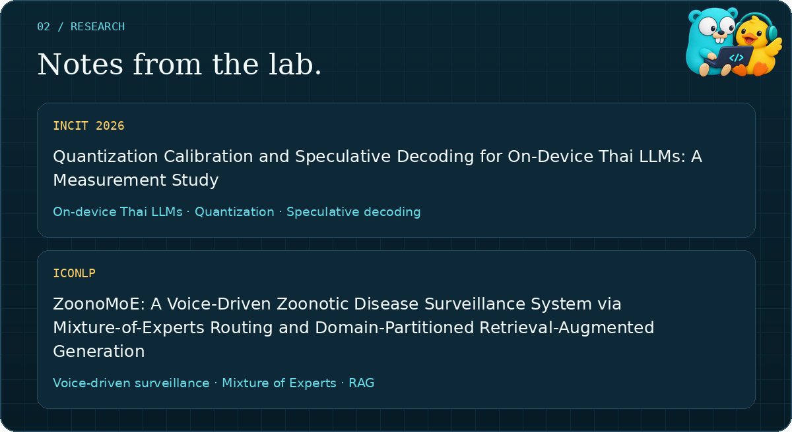
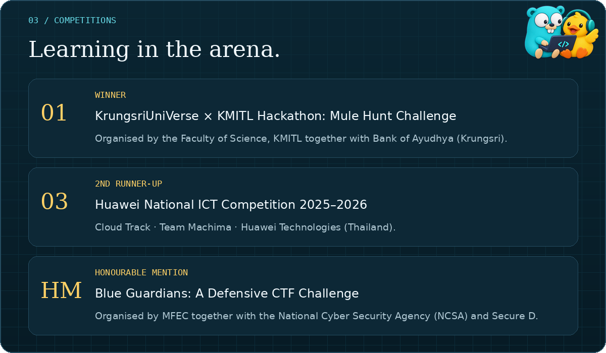
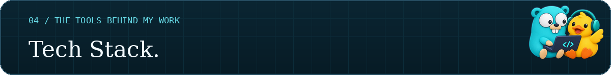

<picture>
  <source media="(prefers-reduced-motion: reduce) and (max-width: 640px)" srcset="./assets/profile/hero-mobile.png">
  <source media="(prefers-reduced-motion: reduce)" srcset="./assets/profile/hero.png">
  <source media="(max-width: 640px)" srcset="./assets/profile/hero-mobile.gif">
  
</picture>

  
  
  
  
  

<picture>
  <source media="(max-width: 640px)" srcset="./assets/profile/about-mobile.png">
  
</picture>

<picture>
  <source media="(max-width: 640px)" srcset="./assets/profile/projects-mobile.png">
  
</picture>

<a href="https://github.com/13D4C/Physical-Com-Project">Smart Farm IoT repository ↗</a> · <a href="https://13d4c.github.io/Physical-Com-Project/">Smartpot website ↗</a> · <a href="https://atibodee.13chady.com">Portfolio ↗</a>

<picture>
  <source media="(max-width: 640px)" srcset="./assets/profile/research-mobile.png">
  
</picture>

<picture>
  <source media="(max-width: 640px)" srcset="./assets/profile/awards-mobile.png">
  
</picture>

<picture>
  <source media="(max-width: 640px)" srcset="./assets/profile/techstack-mobile.png">
  
</picture>

### Languages

### Web

### Databases

   

### Deployment & IaC

  

### Cloud

 

### AI / ML

      

### Networking

   

### Monitoring & Testing

     

### Hardware

 

### Systems & Tools

   

### Design

<picture>
  <source media="(max-width: 640px)" srcset="./assets/profile/certifications-mobile.png">
  
</picture>

<strong>Read the full profile and complete technology stack as text</strong>

## About me

I'm D, an IT student at KMITL. I work across web development, cloud infrastructure, networking, and AI projects. Like a duck, I enjoy adapting to different environments and learning how the pieces fit together.

- **Name:** Atibodee Kuiprasert (D)
- **Education:** Faculty of Information Technology, KMITL
- **Based in:** Thailand

## Selected work

### D-judge / Judge-DD

**Project co-owner** — An AI-assisted homework assessment system with tools for grading submissions and generating rubrics.

### IT KMITL Timetable

**Project Manager & Frontend Developer** — A website for viewing class and examination schedules, with timetable export as an image.

### Smartpot / Smart Farm IoT

**Team project member** — A physical computing project for environmental monitoring and automated plant watering, using ESP32 and sensors.

[View repository](https://github.com/13D4C/Physical-Com-Project)

### Teaching Assistant

Faculty of Information Technology, KMITL

Computer Networks · Object-Oriented Programming · Data Structures & Algorithms

## Research

- **Quantization Calibration and Speculative Decoding for On-Device Thai LLMs: A Measurement Study** — *INCIT 2026*
- **ZoonoMoE: A Voice-Driven Zoonotic Disease Surveillance System via Mixture-of-Experts Routing and Domain-Partitioned Retrieval-Augmented Generation** — *ICONLP*

## Competitions

- **Winner** — KrungsriUniVerse × KMITL Hackathon: Mule Hunt Challenge. Organised by the Faculty of Science, KMITL together with Bank of Ayudhya (Krungsri).
- **2nd Runner-up** — Huawei National ICT Competition 2025–2026. Cloud Track · Team Machima · Huawei Technologies (Thailand).
- **Honourable Mention** — Blue Guardians: A Defensive CTF Challenge. Organised by MFEC together with the National Cyber Security Agency (NCSA) and Secure D.

## Skills & tools

| Area | Technologies |
| :-- | :-- |
| **Languages** | Go, Python, TypeScript, JavaScript, Java, C++, C#, Bash |
| **Web** | HTML, CSS, Svelte, Next.js, Tailwind CSS |
| **Databases** | PostgreSQL, MongoDB, MariaDB, ClickHouse, SQL |
| **Deployment & IaC** | Docker, Podman, Terraform, OpenTofu, Ansible |
| **Cloud** | AWS, GCP, Azure, Cloudflare, Huawei Cloud |
| **AI / ML** | PyTorch, TensorFlow, OpenCV, YOLO, Ollama, Qwen, DeepSeek, Gemma, VLM |
| **Networking** | Cisco, Huawei, Palo Alto, Fortinet |
| **Monitoring & Testing** | Grafana, Prometheus, k6, Loki, Tempo, Mimir, Cloudprober |
| **Hardware** | Raspberry Pi, Arduino, Jetson Nano |
| **Systems & Tools** | Linux, Nginx, GitLab, Git, Airflow, Tailscale, Proxmox |
| **Design** | Figma, Illustrator, Photoshop, Premiere Pro, After Effects |

## Certifications

- **HCCDA — Tech Essentials** · Huawei
- **HCCDP — Solution Architect** · Huawei

## Connect

- [Portfolio](https://atibodee.13chady.com)
- [LinkedIn](https://www.linkedin.com/in/atibodee-kuiprasert-a745a0259/)
- [GitHub](https://github.com/13D4C)
- [Facebook](https://www.facebook.com/profile.php?id=100016991280897)
- [Instagram](https://www.instagram.com/anan13_crow/)

<a href="https://atibodee.13chady.com">
<picture>
  <source media="(prefers-reduced-motion: reduce) and (max-width: 640px)" srcset="./assets/profile/footer-mobile.png">
  <source media="(prefers-reduced-motion: reduce)" srcset="./assets/profile/footer.png">
  <source media="(max-width: 640px)" srcset="./assets/profile/footer-mobile.gif">
  
</picture>
</a>

Go Gopher by [Renée French](https://go.dev/blog/gopher), [CC BY 4.0](https://creativecommons.org/licenses/by/4.0/). Mascot duo: AI-generated adaptation with an original duck.
