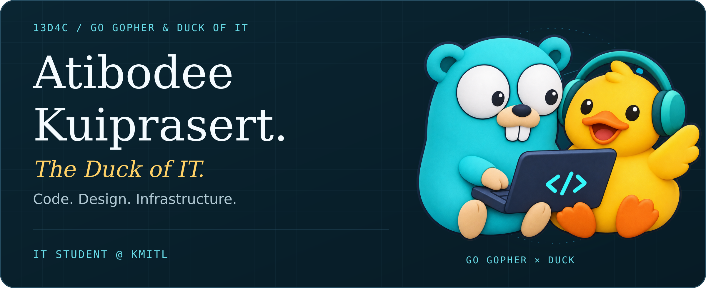
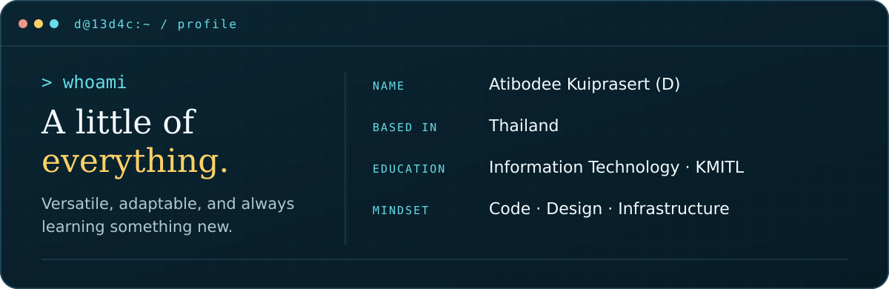
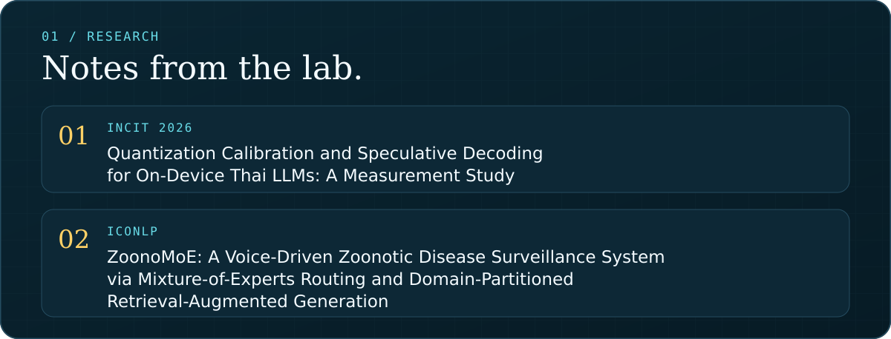
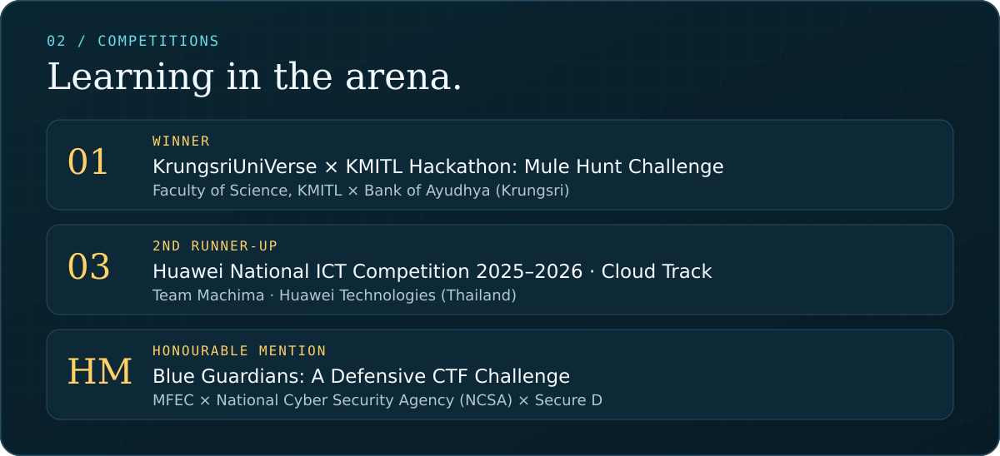
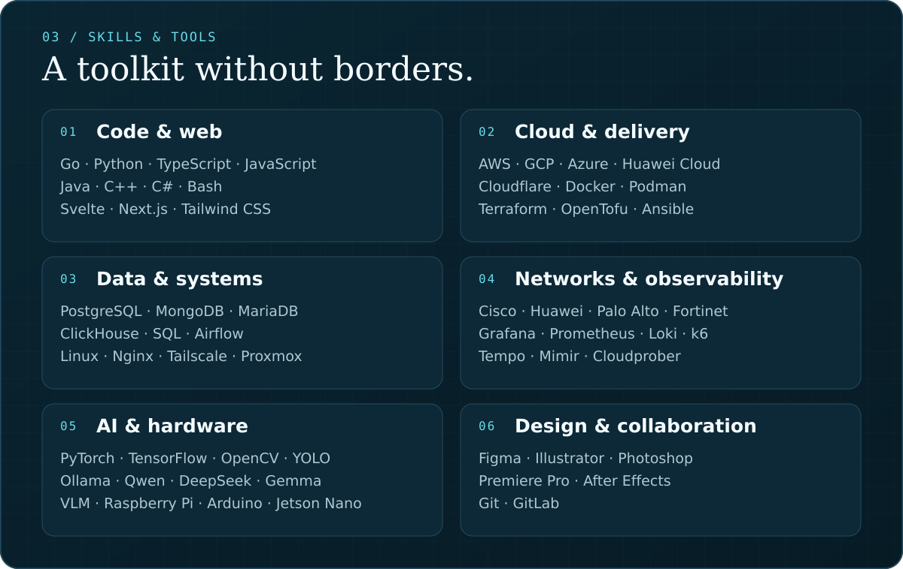
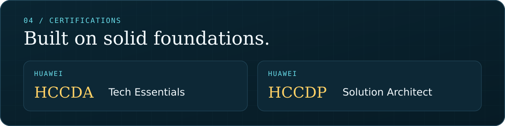
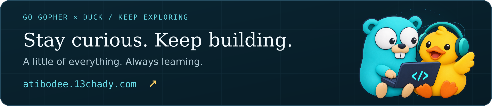

<picture>
  <source media="(max-width: 640px)" srcset="./assets/profile/hero-mobile.png">
  
</picture>

  
  
  
  
  

<picture>
  <source media="(max-width: 640px)" srcset="./assets/profile/about-mobile.svg">
  
</picture>

<picture>
  <source media="(max-width: 640px)" srcset="./assets/profile/research-mobile.svg">
  
</picture>

<picture>
  <source media="(max-width: 640px)" srcset="./assets/profile/awards-mobile.svg">
  
</picture>

<picture>
  <source media="(max-width: 640px)" srcset="./assets/profile/toolkit-mobile.svg">
  
</picture>

<picture>
  <source media="(max-width: 640px)" srcset="./assets/profile/certifications-mobile.svg">
  
</picture>

<strong>Read the full profile &amp; complete technology stack as text</strong>

## 🦆 About Me

> *"My name is D, and I am a student at the Faculty of Information Technology, KMITL. I consider myself the 'Duck of IT'—versatile, adaptable, and dedicated to enhancing my skills in various areas. I hope you will appreciate my efforts!"*

- 🌍 Based in **Thailand**
- 🎓 Studying at **Faculty of Information Technology, KMITL**
- 🌱 Always learning and exploring new technologies
- ⚡ **Fun fact:** Like a duck, I can adapt to any environment—whether it's coding, designing, or infrastructure!

---

## 💻 Skills & Tools

| Area | Stack |
| :-- | :-- |
| **Languages** |  |
| **Web** |  |
| **Databases** |     |
| **Deployment & IaC** |    |
| **Cloud** |   |
| **AI / ML** |        |
| **Networking** |     |
| **Monitoring & Testing** |       |
| **Hardware** |   |
| **Systems & Tools** |     |
| **Design** |  |

---

## 📚 Research

- **Quantization Calibration and Speculative Decoding for On-Device Thai LLMs: A Measurement Study** — *INCIT 2026*
- **ZoonoMoE: A Voice-Driven Zoonotic Disease Surveillance System via Mixture-of-Experts Routing and Domain-Partitioned Retrieval-Augmented Generation** — *ICONLP*

---

## 🏆 Competitions

- 🥇 **Winner** — KrungsriUniVerse × KMITL Hackathon: *Mule Hunt Challenge*
  Organised by the Faculty of Science, KMITL together with Bank of Ayudhya (Krungsri).
- 🥈 **2nd Runner-up** — Huawei National ICT Competition 2025–2026, *Cloud Track* (Team Machima)
  Organised by Huawei Technologies (Thailand).
- 🏅 **Honourable Mention** — Blue Guardians: A Defensive CTF Challenge
  Organised by MFEC together with the National Cyber Security Agency (NCSA) and Secure D.

---

## 📜 Certifications

- **HCCDA — Tech Essentials** · Huawei
- **HCCDP — Solution Architect** · Huawei

---

## 🤝 Connect with Me

- 🌐 **Portfolio** — [atibodee.13chady.com](https://atibodee.13chady.com)
- 💼 **LinkedIn** — [Atibodee Kuiprasert](https://www.linkedin.com/in/atibodee-kuiprasert-a745a0259/)
- 🐙 **GitHub** — [@13D4C](https://github.com/13D4C)
- 📘 **Facebook** — [Atibodee Kuiprasert](https://www.facebook.com/profile.php?id=100016991280897)
- 📷 **Instagram** — [@anan13_crow](https://www.instagram.com/anan13_crow/)

<a href="https://atibodee.13chady.com">
<picture>
  <source media="(max-width: 640px)" srcset="./assets/profile/footer-mobile.png">
  
</picture>
</a>

Go Gopher by [Renée French](https://go.dev/blog/gopher), [CC BY 4.0](https://creativecommons.org/licenses/by/4.0/). Mascot duo artwork: AI-generated adaptation with an original duck.
